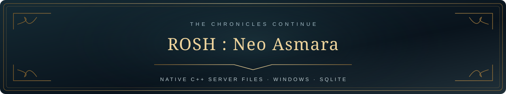
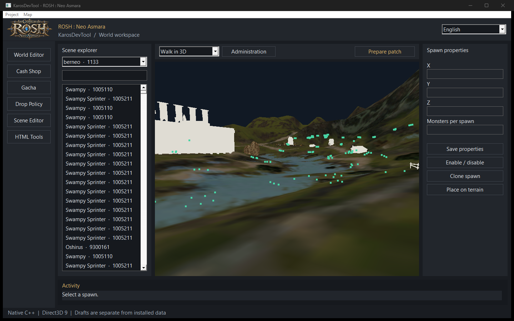
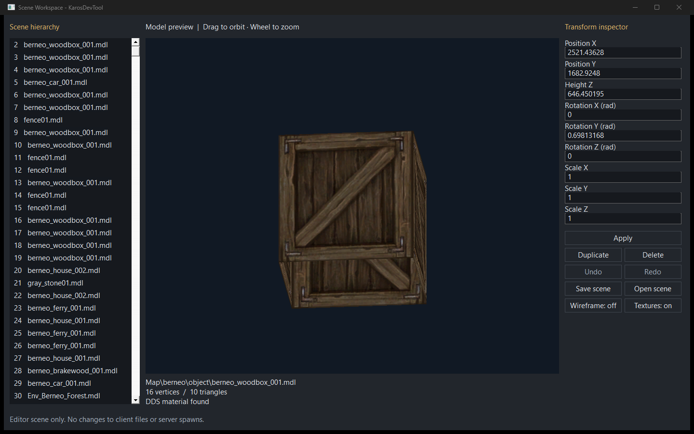

# KarosDevTool — NeoAsmara DevToolKit

Native Windows editing tools for ROSH : Neo Asmara. The main application is C++20 with a Direct3D 9 viewport. It does not need a browser, a local HTTP server, Python or a source checkout for its native functions.

## Start

1. Open `KarosDevTool.exe`.
2. Select the intended Core installation if prompted. Choose the folder containing `Config/server.json`.
3. Pick a map in **World Editor**. Search for a spawn, inspect its coordinates and edit a draft.

The public package defaults to the adjacent `NeoAsmara Core++` folder. If it was moved or renamed, the editor searches nearby Core installations and offers a folder picker when needed. It saves the chosen locations in `Editor.settings.json`.

Keep `KarosDevTool.exe`, `DevContent.exe`, `libc++.dll`, `libunwind.dll` and `Assets` together. Use a writable folder. The full public package carries its extracted map resources under `Assets/ResUnpak`; it does not require the developer's client folder. `ResourceRoot` can point to another existing extraction instead of duplicating it.

## Native tools

| Module | Available workflow |
|---|---|
| World Editor | Existing maps, terrain, supported scenery, spawn search, properties, clone/enable/disable, terrain placement, anchored 2D zoom, orbit and walk views |
| Cash Shop | Product groups with purchase options, price editing, product renaming, addition/removal, category/subcategory creation, renaming, deletion with reassignment and product assignment |
| Gacha | Five native machines, add/remove prizes, edit quantity, weight and grade; up to 1,000 prizes per pool |
| Drop Policy | Edit the supported global drop-distance settings |
| Scene Editor | Select existing scenery, inspect a supported textured model, orbit/zoom, wireframe, texture toggle, position/rotation/scale, duplicate/delete, Undo/Redo and editor-scene save/open |

## Scene Editor

Open **Scene Editor** from the left navigation. Select a model in the hierarchy, drag the preview to orbit and use the mouse wheel to zoom. Change the transform fields and press **Apply**. Rotations are in radians. **Duplicate**, **Delete**, **Undo** and **Redo** operate on the working scene; deletion asks for confirmation.

**Save scene** writes `Workspace/<map>.neoscene.json`. **Open scene** reloads the saved scene for that map. Unsaved changes require a discard confirmation when closing. Saved files identify themselves as editor scenes, record relative model paths and validate transforms and resource boundaries when opened.

These scenes are **editor-only**. They are not Karos client scene files and are not exported into client packages. Opening or editing them does not change server spawns, client models, accounts or characters. Supported proprietary assets remain read-only.

## Cash Shop and Gacha

Cash products expose their existing duration/item variants through **Purchase option**. Categories can contain subcategories. Removing a category requires a valid destination for its products; removing a product stops its sale without deleting owned items or purchase history. Double-click a product to rename it.

Gacha prize rows are editable and can be added or removed. A pool must retain at least one valid prize. The five-machine protocol and 1,000-prize bound are retained. Buff-preset authoring, buying-time buff choices, machine-cost editing and a normalized-chance display remain pending; this build does not claim to implement them.

Catalog names come from the selected Core. Custom product names and localized game data are preserved; the native interface itself uses English by default.

## Prepare and apply a patch

1. Save your server-data drafts.
2. Click **Prepare patch** and review the generated package and `native-patch.json`.
3. Stop the selected Core normally. Do not apply a patch to running services.
4. Run the package's `AplicarPatch.exe`, keeping its data and runtime DLLs together.
5. Restart that same Core after verification succeeds.

The patch checks the original content hash and its affected files, validates the edited catalogs and restores files if application fails. Data-only packages do not copy a developer-build runtime DLL. Replacing a Gacha pool archives and clears only that pool's positional prize overrides so old rows cannot silently replace the new prizes.

Scene workspace files are not server-content patches. Changing game-client resources requires a separate tested client publication with matching native resource checks, protected hashes and signed updates.

## Requirements

- Windows x64 with a working Direct3D 9 graphics driver; tested locally on Windows 11 IoT.
- Included LLVM runtime DLLs and Windows GDI+/CNG/DPAPI/SQLite components.
- An initialized compatible NeoAsmara Core and the included supported visual resources.
- No Qt, browser, Python, SQL Server or compiler required to run the native edition.

## Validation and limits

Tests exercised real Berneo model/DDS rendering, transforms, duplication, Undo/Redo, scene round-trip, invalid paths and transforms, anchored 2D zoom, native category validation, Gacha row operations, actual isolated patch application and relocation into renamed folders. They do not establish full support for every proprietary model or animation.

Current model support is limited to the existing understood static scenery chain. Some multi-material scenery appears without its textures. Skeletal animation, all creature/character formats, transform gizmos, multiple selection, a complete asset/dependency browser, asynchronous resource loading, configurable cache/retention and proprietary scene export remain unfinished. No client-compatible format is invented or advertised for these features.

The separate legacy HTML toolset is retained in the local development installation under `KarosHtmlTools.exe`; it is not a dependency of this native public package. Its native migration and complete English translation remain separate work.

---

[Support development on Ko-fi](https://ko-fi.com/neoasmara) — optional donations.

## License

Copyright © 2026 LuspX_

This repository is part of the **NeoAsmara Project** and is distributed under the **NeoAsmara Project License v1.0 (NAPL)**.

The license permits personal research, local testing, and authorized reverse engineering, while reserving commercial redistribution rights.

See [LICENSE.md](LICENSE.md) for the complete terms.

**NeoAsmara is an independent, unofficial project.**
